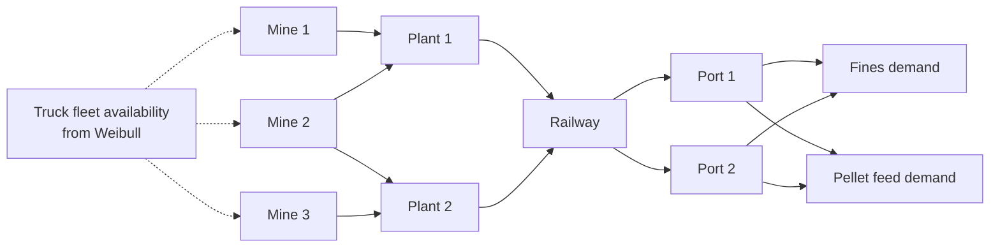

# Blueprint: Mine-to-port planning and fleet reliability

Technical design for this project. The backlog lives in the [epic](https://github.com/stephanyalves-eng/p4-mine-to-port-planning/issues/1); each section below names the issues that deliver it.

## 1. Business question

How should production from 3 mines, 2 processing plants, one railway and 2 ports be allocated to maximize margin within the contracted iron grade, and which constraint is most worth relieving: mine capacity, rail, port or haul truck fleet availability?

**Decision supported:** the monthly allocation plan and where the next investment goes, ranked by shadow price.

**Public anchor:** the network is fictional, but its scale comes from public data. Vale kept its 2026 iron ore guidance at 335–345 Mt and produced 84.3 Mt in Q2 2026, with a rainy-season dip in the first quarter. Linking optimization to fleet reliability draws on my postgraduate degree in maintenance engineering.

## 2. Scope

| In scope | Out of scope |
|---|---|
| Fictional network: 3 mines, 2 plants, 1 railway, 2 ports, 2 products (fines, pellet feed) | Real Vale asset data |
| Quarterly production series from Vale reports, iron ore price from the Pink Sheet | Mine scheduling at block level |
| LP model in PuLP, scenarios, shadow prices | Stochastic or multi-period optimization |
| Weibull analysis of 40 haul trucks and age-replacement policy | Real maintenance records |
| S&OP dashboard and a 5-slide deck | |

## 3. KPIs and acceptance

| KPI | Definition | Target / check |
|---|---|---|
| Total margin | Σ (price − variable cost) × tonnes shipped | Optimal value of the LP |
| Utilization per link | Flow / capacity for each mine, plant, rail and port | Active constraints identified |
| Shadow prices | Margin gain per extra tonne of capacity on each constraint | Ranks where to invest |
| Grade compliance | Blend Fe % per product | ≥ contracted minimum in every solution |
| Fleet availability | MTBF / (MTBF + MTTR) | Fed into mine capacity in the LP |

## 4. Data sources

| Source | What it provides | Access | License | Script |
|---|---|---|---|---|
| [Vale quarterly production reports](https://vale.com/investors) | Quarterly iron ore production 2024–2026, annual guidance | Quarterly PDF; from Q3 2026 in the unified performance report | Public | Transcribed to `data/vale_quarterly.csv` with page references |
| [World Bank Pink Sheet](https://www.worldbank.org/en/research/commodity-markets) | Monthly iron ore price | Excel download | CC BY 4.0 | `src/data/download_pinksheet.py` |
| Fictional network | Capacities, Fe grades per mine, costs, demand per product | `data/network.yaml` | Generated, MIT | Committed, documented |
| Fleet failure generator | Time between failures for 40 trucks, with right-censored records | `src/generate/fleet.py` | Generated, MIT | Seeded, true β and η saved |

## 5. Model



**Formulation (written in full in the README before coding, issue #4)**

- Decision variables: flow x on each arc, by product.
- Objective: maximize Σ (price − cost) × flow.
- Constraints: capacity on every node and arc; flow balance at plants, railway and ports; blend constraint Σ Fe·x ≥ Fe_min · Σ x for each product; demand limits per product; mine capacity scaled by fleet availability.

## 6. Method by stage

| Stage | Issues | Method | Output |
|---|---|---|---|
| Calibration | #2 | Vale quarterly series 2024–2026; first-quarter seasonal factor | `data/vale_quarterly.csv` |
| Network | #3 | Fictional network scaled to ~340 Mt per year | `data/network.yaml` |
| Equations | #4 | Full mathematical formulation in the README | README model section |
| LP model | #5 | PuLP model; validated on a small instance also solved in Excel Solver (both must match); optimal plan, active constraints, shadow prices | `src/lp_model.py` |
| Scenarios | #6 | Q1 rain (mine capacity −15%), 10-day rail outage, 20% price drop, port expansion; compare margin and shadow prices | Scenario table |
| Forecast | #7 | Exponential smoothing with seasonality on 12 quarters, used as a scenario, not a reliable forecast | Forecast notebook |
| Fleet data | #8 | Time between failures for 40 haul trucks, with censored records | `src/generate/fleet.py` |
| Weibull | #9 | Fit β and η with censoring; interpret β (below 1 infant mortality, above 1 wear-out); MTBF and availability | Weibull plot and table |
| Preventive policy | #10 | Age-replacement model: interval that minimizes cost per hour | Optimal interval |
| Integration | #11 | Fleet availability becomes a mine capacity constraint in the LP | Updated LP results |
| S&OP | #12, #13 | Tableau Public dashboard: demand × capacity × plan; 5-slide monthly S&OP deck with the decision asked of leadership; case study | v1.0 release |

## 7. Repository layout

```
data/
  vale_quarterly.csv           # transcribed, with source pages
  network.yaml                 # capacities, grades, costs, demand
src/
  data/download_pinksheet.py
  generate/fleet.py            # failure data with censoring, fixed seed
  lp_model.py                  # PuLP formulation, shadow prices
  scenarios.py
  forecast.py                  # ETS
  reliability.py               # Weibull fit, MTBF, age replacement
notebooks/
  01_calibration.ipynb
  02_lp_and_scenarios.ipynb
  03_fleet_reliability.ipynb
reports/sop_deck.pdf
dashboard/                     # link to Tableau Public
tests/                         # LP small instance, Weibull truth recovery
```

## 8. Validation and tests

- **Excel Solver match:** the small instance must give the same objective value and flows in PuLP and in Excel Solver.
- **Constraint checks:** every solution respects capacities, flow balance and the Fe blend minimum.
- **Shadow price sanity:** relaxing an active constraint by one tonne changes the objective by its shadow price; a slack constraint has a shadow price of zero.
- **Weibull truth recovery:** fitted β and η land close to the generator's true values, including with censored records.
- CI runs `ruff check`, `ruff format --check` and `pytest` on every PR.

## 9. Deliverables and releases

| Release | Content |
|---|---|
| v0.1 | Calibration, network, LP model, scenarios, forecast |
| v1.0 | Fleet reliability, integration into the LP, S&OP dashboard, deck, case study |

## 10. Assumptions and risks

| Item | Mitigation |
|---|---|
| 12 quarterly points are too few for a reliable forecast | Present the forecast as a scenario and state the limitation |
| Vale changed its report format from Q3 2026 | Transcribe by hand with page references; keep the series short |
| Fictional grades and costs drive the answer | Keep them in one YAML file and show sensitivity of the shadow prices |
| Weibull fit with few failures is unstable | Use enough trucks and failures, and report confidence bounds on β and η |

## 11. Variants

- **Anglo American Minas-Rio:** replace the railway with a slurry pipeline to the port. The transport constraint becomes continuous flow instead of train batches; the model structure stays the same.
- **Oil and gas (stretch):** the same LP allocating field production to terminals, using volumes per field from ANP dashboards.

## 12. Division of work with AI

Claude writes the PuLP formulation from my mathematical specification. I write the equations in the README before asking for code: if I cannot write a constraint, I have not understood the problem yet.
